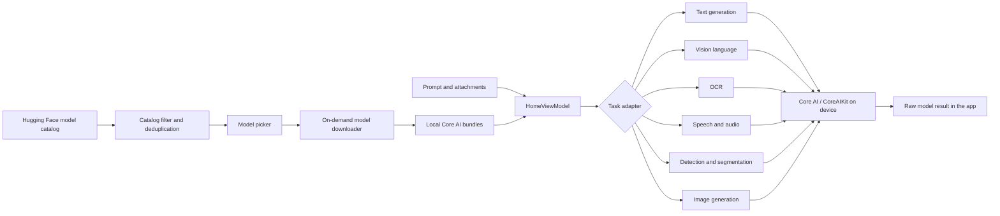
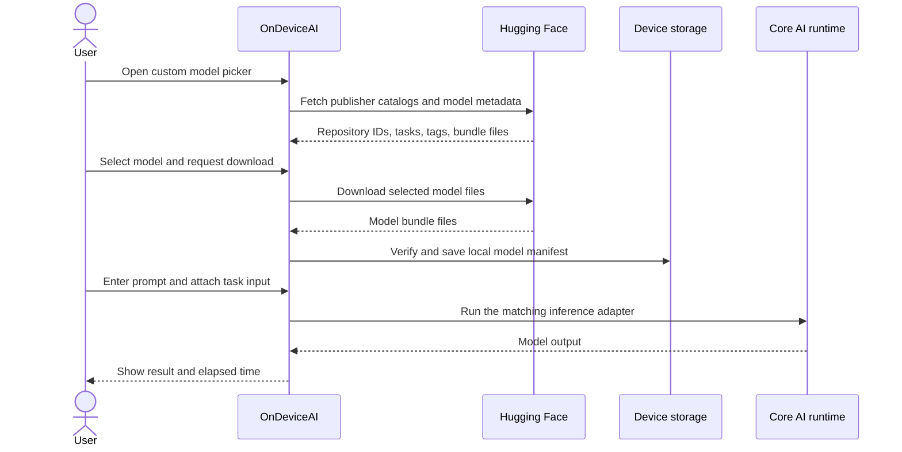

# OnDeviceAI

OnDeviceAI is an iOS app for exploring and running Apple Core AI models locally. It provides an Apple Intelligence mode and a custom-model mode. The custom-model picker reads model metadata from Hugging Face, filters repositories for Core AI model bundles, avoids duplicate model entries, and downloads selected assets on demand. Inference uses task-specific Swift providers over Core AI and the CoreAIKit utilities.

> **Catalog, adapter, and test status are different.** A model in the picker passed the catalog's bundle and metadata filter; that alone does not mean this app has an inference adapter for its task. Only the model families listed under [Implemented inference adapters](#implemented-inference-adapters) have a corresponding execution path. Only the two models in [On-device test record](#on-device-test-record) have confirmed manual inference results recorded here.

## Requirements

- iOS 27 or later, on a compatible iPhone or iPad. Core AI APIs used by the app require the iOS 27 SDK/runtime.
- Xcode with the iOS 27 SDK and an Apple Silicon device for physical-device inference.
- Network access for the first catalog load and model download. Inference uses the downloaded model on device.
- Free device storage for the selected model. Some bundles are multiple gigabytes; the picker shows the estimated download size before downloading.

## Architecture

The catalog and model assets come from Hugging Face. The app selects an adapter based on the model task and, for model families with custom bundle layouts, the repository ID. The response is shown in the result card.

The user-facing model flow is:

### Main code areas

| Area | Responsibility |
| --- | --- |
| `OnDeviceAI/Home/` | Main screen, prompt and attachments, model selection, execution state, and result display. |
| `OnDeviceAI/ModelPicker/Services/CoreAIModelCatalogService.swift` | Hugging Face catalog queries, Core AI/iOS bundle filtering, task labels, and duplicate preference. |
| `OnDeviceAI/ModelPicker/Downloads/` | Model downloads, progress, local manifests, and bundle discovery. |
| `OnDeviceAI/Providers/` | Task adapters for text, OCR, MiniCPM-V, speech, image tasks, and FLUX.2. |
| `OnDeviceAI/Testing/CoreAIModelPilot.swift` | Debug-only device pilot that downloads and exercises a set of representative models. |

## Implemented inference adapters

These are execution paths in the current app. Compatibility still depends on the selected repository's actual bundle files and metadata.

| Task | Current app path | Models/family constraints |
| --- | --- | --- |
| Text generation | Core AI language-model bundle and tokenizer | Repositories tagged `text-generation` with the expected `.aimodel` metadata and tokenizer. |
| Image-to-text / OCR | OCR provider | GLM-OCR repository variants and `coreai-community/Unlimited-OCR-CoreAI`. |
| Image-text-to-text | MiniCPM-V 4.6 provider | `coreai-community/MiniCPM-V-4.6-CoreAI` and `mlboydaisuke/MiniCPM-V-4.6-CoreAI`; catalog prefers the latter. |
| Text-to-speech | Audio8 provider | `coreai-community/Audio8-TTS-Preview-0.6b-CoreAI`. |
| Speech recognition | Core AI speech recognition bundle discovery | Models must expose compatible speech metadata/assets; Parakeet is included in the pilot harness. |
| Object detection | Core AI ObjectDetector | Requires a compatible detector bundle and metadata. |
| Image segmentation | Core AI ImageSegmenter | Requires a bundle with `kind: segmenter`. |
| Text-to-image | FLUX.2 diffusion pipeline | Currently only `grabbou/FLUX.2-klein-4B-CoreAI`, with its iOS diffusion bundles. |

Other repositories can appear in the live catalog even when no app adapter exists for their task or their specific export. In that case, the app reports that it cannot run the selected model. The catalog is not a guarantee that every listed model can be executed by this app.

## On-device test record

Manual results confirmed on the connected **iPad Pro 11-inch (4th generation), iPadOS 27.0.1**:

| Model | Result | What was exercised |
| --- | --- | --- |
| [`mlboydaisuke/GLM-OCR-CoreAI`](https://huggingface.co/mlboydaisuke/GLM-OCR-CoreAI) | **Completed** (16.5 s in the recorded run) | Attached a document image and requested OCR. It returned text, with some redundant token artifacts and recognition errors; completion confirms the inference path, not OCR quality. |
| [`mlboydaisuke/MiniCPM-V-4.6-CoreAI`](https://huggingface.co/mlboydaisuke/MiniCPM-V-4.6-CoreAI) | **Completed** (58.2 s in the recorded run) | Downloaded the current 1.94 GB bundle, attached the document photo, and asked “Read the text in this document.” It returned a concise transcription with some recognition errors. |

The app's debug pilot is configured for these eight representative repositories. The repository contains the pilot code, but it does not contain recorded pass/fail logs for these eight runs, so they are listed as pilot targets rather than confirmed passes.

| Pilot target | Task |
| --- | --- |
| `coreai-community/LFM2.5-1.2B-CoreAI` | Text generation |
| `coreai-community/MiniCPM5-1B-CoreAI` | Text generation |
| `coreai-community/Unlimited-OCR-CoreAI` | OCR |
| `coreai-community/Audio8-TTS-Preview-0.6b-CoreAI` | Text-to-speech |
| `coreai-community/Parakeet-TDT-0.6B-CoreAI` | Speech recognition |
| `coreai-community/RF-DETR-CoreAI` | Object detection |
| `grabbou/EfficientSAM-Ti-CoreAI` | Image segmentation |
| `grabbou/FLUX.2-klein-4B-CoreAI` | Text-to-image |

### Manual testing steps

1. Open `OnDeviceAI.xcodeproj` in Xcode, select the **OnDeviceAI** scheme, and choose a connected iPhone or iPad running iOS 27 or later. Resolve Swift packages if Xcode asks.
2. Build and run the app on the device. On first launch, select **Custom Model**, then tap **Switch** to open the model picker.
3. Search for the repository/model name. Confirm the publisher and task, check the shown download size, and tap the download control. Keep the app open until the download finishes.
4. Select the downloaded model in the picker and tap **Done**.
5. Provide inputs for that task: attach exactly one image for OCR or vision-language, one audio file for speech recognition, and no attachment for text generation, text-to-speech, or FLUX.2 image generation. Enter a short prompt when the task uses one.
6. Tap **Run Agent**. Wait for the result card to show **Completed**, then inspect the output. A completed status means the inference path returned a result; evaluate content quality separately against the input.

A first run can take longer while the Core AI runtime prepares a model. Downloads can be large; MiniCPM-V 4.6 was about 1.94 GB in the recorded run. Do not treat the picker label or successful download alone as an inference test.

### Debug pilot from Xcode

For the pilot harness, open **Product → Scheme → Edit Scheme → Run → Arguments Passed On Launch** and add one of these arguments:

- `--coreai-model-pilot` downloads and runs the eight pilot targets above.
- `--coreai-model-pilot-rfdetr` runs only RF-DETR.
- `--coreai-model-pilot-glm-ocr` runs only GLM-OCR using a generated image fixture.

The full pilot downloads several large models and ends with Unlimited-OCR. The current code comments that the Unlimited-OCR vision graph can abort inside the OS Core AI compiler on some system/toolchain versions; if that happens, the process may terminate before printing a normal Swift error. To isolate a model, use the single-model flags where available or test through the app UI. Pilot output is printed to the Xcode debug console with `PILOT RESULT` lines.

## Hugging Face model catalog snapshot

The catalog is fetched live from the Hugging Face API for these publishers: [`coreai-community`](https://huggingface.co/coreai-community), [`mlboydaisuke`](https://huggingface.co/mlboydaisuke), and [`grabbou`](https://huggingface.co/grabbou). This inventory was captured on **2026-11-27** by applying the current `CoreAIModelCatalogService` filter and duplicate preference rules: **114 unique repositories**. The picker remains dynamic; the list and count may change as publishers add, remove, or revise repositories.

The service filter is a metadata and bundle-presence check, not a certification that every entry runs on every iOS device. It accepts an iOS-named model bundle directory or a root-level Core AI bundle with matching tags. Check each model card for its intended Apple platform, memory needs, and hardware requirements before downloading; some entries may target another Apple platform or exceed a device's available memory.

The category uses the same pipeline-task keyword rules as the picker. `Other` means the task metadata does not map to the picker's Text, Vision, or Audio filters. **Catalog inclusion does not imply an inference adapter is implemented.**

### Text

| Model | Hugging Face repository | Task |
| --- | --- | --- |
| `Agents-A1-4B-CoreAI` | [mlboydaisuke/Agents-A1-4B-CoreAI](https://huggingface.co/mlboydaisuke/Agents-A1-4B-CoreAI) | Text Generation |
| `BitCPM-8B-CoreAI` | [coreai-community/BitCPM-8B-CoreAI](https://huggingface.co/coreai-community/BitCPM-8B-CoreAI) | Text Generation |
| `decider-0.8b-CoreAI` | [mlboydaisuke/decider-0.8b-CoreAI](https://huggingface.co/mlboydaisuke/decider-0.8b-CoreAI) | Text Classification |
| `embeddinggemma-300m-CoreAI` | [coreai-community/embeddinggemma-300m-CoreAI](https://huggingface.co/coreai-community/embeddinggemma-300m-CoreAI) | Feature Extraction |
| `FastContext-1.0-4B-CoreAI` | [coreai-community/FastContext-1.0-4B-CoreAI](https://huggingface.co/coreai-community/FastContext-1.0-4B-CoreAI) | Text Generation |
| `Gemma-4-12B-CoreAI` | [mlboydaisuke/Gemma-4-12B-CoreAI](https://huggingface.co/mlboydaisuke/Gemma-4-12B-CoreAI) | Text Generation |
| `Gemma-4-31B-CoreAI` | [mlboydaisuke/Gemma-4-31B-CoreAI](https://huggingface.co/mlboydaisuke/Gemma-4-31B-CoreAI) | Text Generation |
| `gemma-4-E2B-CoreAI` | [mlboydaisuke/gemma-4-E2B-CoreAI](https://huggingface.co/mlboydaisuke/gemma-4-E2B-CoreAI) | Text Generation |
| `gemma-4-E4B-CoreAI` | [mlboydaisuke/gemma-4-E4B-CoreAI](https://huggingface.co/mlboydaisuke/gemma-4-E4B-CoreAI) | Text Generation |
| `GLiNER2-PII-CoreAI` | [coreai-community/GLiNER2-PII-CoreAI](https://huggingface.co/coreai-community/GLiNER2-PII-CoreAI) | Token Classification |
| `GLiNER2.5-Decide-CoreAI` | [coreai-community/GLiNER2.5-Decide-CoreAI](https://huggingface.co/coreai-community/GLiNER2.5-Decide-CoreAI) | Text Classification |
| `GLM-4.7-Flash-CoreAI` | [mlboydaisuke/GLM-4.7-Flash-CoreAI](https://huggingface.co/mlboydaisuke/GLM-4.7-Flash-CoreAI) | Text Generation |
| `Granite-Embedding-97M-Multilingual-R2-CoreAI` | [coreai-community/Granite-Embedding-97M-Multilingual-R2-CoreAI](https://huggingface.co/coreai-community/Granite-Embedding-97M-Multilingual-R2-CoreAI) | Sentence Similarity |
| `Julia-1-CoreAI` | [mlboydaisuke/Julia-1-CoreAI](https://huggingface.co/mlboydaisuke/Julia-1-CoreAI) | Text Classification |
| `Kev-0.8B-CoreAI` | [mlboydaisuke/Kev-0.8B-CoreAI](https://huggingface.co/mlboydaisuke/Kev-0.8B-CoreAI) | Text Classification |
| `Kev-4B-CoreAI` | [mlboydaisuke/Kev-4B-CoreAI](https://huggingface.co/mlboydaisuke/Kev-4B-CoreAI) | Text Classification |
| `Laya-Multilingual-CoreAI` | [mlboydaisuke/Laya-Multilingual-CoreAI](https://huggingface.co/mlboydaisuke/Laya-Multilingual-CoreAI) | Text Classification |
| `LFM2.5-1.2B-CoreAI` | [coreai-community/LFM2.5-1.2B-CoreAI](https://huggingface.co/coreai-community/LFM2.5-1.2B-CoreAI) | Text Generation |
| `LFM2.5-2.6B-CoreAI` | [mlboydaisuke/LFM2.5-2.6B-CoreAI](https://huggingface.co/mlboydaisuke/LFM2.5-2.6B-CoreAI) | Text Generation |
| `LFM2.5-8B-A1B-CoreAI` | [mlboydaisuke/LFM2.5-8B-A1B-CoreAI](https://huggingface.co/mlboydaisuke/LFM2.5-8B-A1B-CoreAI) | Text Generation |
| `LFM3-1.7B-CoreAI` | [mlboydaisuke/LFM3-1.7B-CoreAI](https://huggingface.co/mlboydaisuke/LFM3-1.7B-CoreAI) | Text Generation |
| `MiniCPM5-1B-CoreAI` | [coreai-community/MiniCPM5-1B-CoreAI](https://huggingface.co/coreai-community/MiniCPM5-1B-CoreAI) | Text Generation |
| `MiniCPM5-2B-CoreAI` | [mlboydaisuke/MiniCPM5-2B-CoreAI](https://huggingface.co/mlboydaisuke/MiniCPM5-2B-CoreAI) | Text Generation |
| `Muse-Glimmer-30B-CoreAI` | [mlboydaisuke/Muse-Glimmer-30B-CoreAI](https://huggingface.co/mlboydaisuke/Muse-Glimmer-30B-CoreAI) | Text Generation |
| `OpenThai-SystemOne-CoreAI` | [mlboydaisuke/OpenThai-SystemOne-CoreAI](https://huggingface.co/mlboydaisuke/OpenThai-SystemOne-CoreAI) | Zero Shot Classification |
| `Ornith-1.0-9B-CoreAI` | [mlboydaisuke/Ornith-1.0-9B-CoreAI](https://huggingface.co/mlboydaisuke/Ornith-1.0-9B-CoreAI) | Text Generation |
| `qwen3-1.7b-CoreAI-official` | [mlboydaisuke/qwen3-1.7b-CoreAI-official](https://huggingface.co/mlboydaisuke/qwen3-1.7b-CoreAI-official) | Text Generation |
| `Qwen3-Embedding-0.6B-CoreAI` | [coreai-community/Qwen3-Embedding-0.6B-CoreAI](https://huggingface.co/coreai-community/Qwen3-Embedding-0.6B-CoreAI) | Sentence Similarity |
| `Qwen3-Reranker-0.6B-CoreAI` | [coreai-community/Qwen3-Reranker-0.6B-CoreAI](https://huggingface.co/coreai-community/Qwen3-Reranker-0.6B-CoreAI) | Text Ranking |
| `qwen3.5-0.8B-CoreAI` | [mlboydaisuke/qwen3.5-0.8B-CoreAI](https://huggingface.co/mlboydaisuke/qwen3.5-0.8B-CoreAI) | Text Generation |
| `qwen3.5-4B-CoreAI` | [mlboydaisuke/qwen3.5-4B-CoreAI](https://huggingface.co/mlboydaisuke/qwen3.5-4B-CoreAI) | Text Generation |
| `Qwen3.6-27B-CoreAI` | [mlboydaisuke/Qwen3.6-27B-CoreAI](https://huggingface.co/mlboydaisuke/Qwen3.6-27B-CoreAI) | Text Generation |
| `Qwen3.6-35B-A3B-CoreAI` | [mlboydaisuke/Qwen3.6-35B-A3B-CoreAI](https://huggingface.co/mlboydaisuke/Qwen3.6-35B-A3B-CoreAI) | Text Generation |
| `RWKV7-Goose-1.5B-CoreAI` | [mlboydaisuke/RWKV7-Goose-1.5B-CoreAI](https://huggingface.co/mlboydaisuke/RWKV7-Goose-1.5B-CoreAI) | Text Generation |
| `S1-mini-CoreAI` | [mlboydaisuke/S1-mini-CoreAI](https://huggingface.co/mlboydaisuke/S1-mini-CoreAI) | Text Generation |
| `Shieldstral-CoreAI` | [mlboydaisuke/Shieldstral-CoreAI](https://huggingface.co/mlboydaisuke/Shieldstral-CoreAI) | Text Classification |

### Vision

| Model | Hugging Face repository | Task |
| --- | --- | --- |
| `AdcSR-CoreAI` | [coreai-community/AdcSR-CoreAI](https://huggingface.co/coreai-community/AdcSR-CoreAI) | Image To Image |
| `clef-flash-CoreAI` | [mlboydaisuke/clef-flash-CoreAI](https://huggingface.co/mlboydaisuke/clef-flash-CoreAI) | Image Text To Text |
| `ColModernVBERT-CoreAI` | [coreai-community/ColModernVBERT-CoreAI](https://huggingface.co/coreai-community/ColModernVBERT-CoreAI) | Visual Document Retrieval |
| `decider-2b-vision-CoreAI` | [coreai-community/decider-2b-vision-CoreAI](https://huggingface.co/coreai-community/decider-2b-vision-CoreAI) | Image Text To Text |
| `Depth-Anything-3-CoreAI` | [coreai-community/Depth-Anything-3-CoreAI](https://huggingface.co/coreai-community/Depth-Anything-3-CoreAI) | Depth Estimation |
| `depth-anything-3-small-CoreAI` | [grabbou/depth-anything-3-small-CoreAI](https://huggingface.co/grabbou/depth-anything-3-small-CoreAI) | Depth Estimation |
| `edsr-x2-CoreAI` | [grabbou/edsr-x2-CoreAI](https://huggingface.co/grabbou/edsr-x2-CoreAI) | Image To Image |
| `FLUX.2-klein-4B-CoreAI` | [mlboydaisuke/FLUX.2-klein-4B-CoreAI](https://huggingface.co/mlboydaisuke/FLUX.2-klein-4B-CoreAI) | Text To Image |
| `GLM-Image-CoreAI` | [mlboydaisuke/GLM-Image-CoreAI](https://huggingface.co/mlboydaisuke/GLM-Image-CoreAI) | Text To Image |
| `GLM-OCR-CoreAI` | [mlboydaisuke/GLM-OCR-CoreAI](https://huggingface.co/mlboydaisuke/GLM-OCR-CoreAI) | Image To Text |
| `Holo2-4B-CoreAI` | [mlboydaisuke/Holo2-4B-CoreAI](https://huggingface.co/mlboydaisuke/Holo2-4B-CoreAI) | Image Text To Text |
| `LFM2.5-VL-3B-CoreAI` | [mlboydaisuke/LFM2.5-VL-3B-CoreAI](https://huggingface.co/mlboydaisuke/LFM2.5-VL-3B-CoreAI) | Image Text To Text |
| `LFM2.5-VL-450M-CoreAI` | [mlboydaisuke/LFM2.5-VL-450M-CoreAI](https://huggingface.co/mlboydaisuke/LFM2.5-VL-450M-CoreAI) | Image Text To Text |
| `LTX-Video-2B-CoreAI` | [mlboydaisuke/LTX-Video-2B-CoreAI](https://huggingface.co/mlboydaisuke/LTX-Video-2B-CoreAI) | Text To Video |
| `MiniCPM-V-4.6-CoreAI` | [mlboydaisuke/MiniCPM-V-4.6-CoreAI](https://huggingface.co/mlboydaisuke/MiniCPM-V-4.6-CoreAI) | Image Text To Text |
| `MiniCPM-V-4.7-1B-CoreAI` | [mlboydaisuke/MiniCPM-V-4.7-1B-CoreAI](https://huggingface.co/mlboydaisuke/MiniCPM-V-4.7-1B-CoreAI) | Image Text To Text |
| `Moebius-CoreAI` | [coreai-community/Moebius-CoreAI](https://huggingface.co/coreai-community/Moebius-CoreAI) | Image To Image |
| `North-Micro-Vision-CoreAI` | [mlboydaisuke/North-Micro-Vision-CoreAI](https://huggingface.co/mlboydaisuke/North-Micro-Vision-CoreAI) | Image Text To Text |
| `pvt-v2-b0-CoreAI` | [grabbou/pvt-v2-b0-CoreAI](https://huggingface.co/grabbou/pvt-v2-b0-CoreAI) | Image Classification |
| `Qwen3.8-27B-CoreAI` | [mlboydaisuke/Qwen3.8-27B-CoreAI](https://huggingface.co/mlboydaisuke/Qwen3.8-27B-CoreAI) | Image Text To Text |
| `Real-ESRGAN-CoreAI` | [coreai-community/Real-ESRGAN-CoreAI](https://huggingface.co/coreai-community/Real-ESRGAN-CoreAI) | Image To Image |
| `RF-DETR-CoreAI` | [coreai-community/RF-DETR-CoreAI](https://huggingface.co/coreai-community/RF-DETR-CoreAI) | Object Detection |
| `RGBA-Image-2.1-CoreAI` | [mlboydaisuke/RGBA-Image-2.1-CoreAI](https://huggingface.co/mlboydaisuke/RGBA-Image-2.1-CoreAI) | Text To Image |
| `RGBA-Image-2.1-Turbo-CoreAI` | [mlboydaisuke/RGBA-Image-2.1-Turbo-CoreAI](https://huggingface.co/mlboydaisuke/RGBA-Image-2.1-Turbo-CoreAI) | Text To Image |
| `sam3-CoreAI-official` | [mlboydaisuke/sam3-CoreAI-official](https://huggingface.co/mlboydaisuke/sam3-CoreAI-official) | Image Segmentation |
| `TripoSplat-CoreAI` | [coreai-community/TripoSplat-CoreAI](https://huggingface.co/coreai-community/TripoSplat-CoreAI) | Image To 3D |
| `Unlimited-OCR-CoreAI` | [coreai-community/Unlimited-OCR-CoreAI](https://huggingface.co/coreai-community/Unlimited-OCR-CoreAI) | Image To Text |
| `VJEPA2-ViTL-SSv2-CoreAI` | [coreai-community/VJEPA2-ViTL-SSv2-CoreAI](https://huggingface.co/coreai-community/VJEPA2-ViTL-SSv2-CoreAI) | Video Classification |
| `Wan2.1-T2V-1.3B-CoreAI` | [grabbou/Wan2.1-T2V-1.3B-CoreAI](https://huggingface.co/grabbou/Wan2.1-T2V-1.3B-CoreAI) | Text To Video |
| `WeVisOne-VL-2B-CoreAI` | [mlboydaisuke/WeVisOne-VL-2B-CoreAI](https://huggingface.co/mlboydaisuke/WeVisOne-VL-2B-CoreAI) | Image Segmentation |
| `yolos-tiny-CoreAI` | [grabbou/yolos-tiny-CoreAI](https://huggingface.co/grabbou/yolos-tiny-CoreAI) | Object Detection |
| `YOLOX-CoreAI` | [coreai-community/YOLOX-CoreAI](https://huggingface.co/coreai-community/YOLOX-CoreAI) | Object Detection |
| `Z-Image-Turbo-CoreAI` | [mlboydaisuke/Z-Image-Turbo-CoreAI](https://huggingface.co/mlboydaisuke/Z-Image-Turbo-CoreAI) | Text To Image |

### Audio

| Model | Hugging Face repository | Task |
| --- | --- | --- |
| `Audio8-TTS-Preview-0.6b-CoreAI` | [coreai-community/Audio8-TTS-Preview-0.6b-CoreAI](https://huggingface.co/coreai-community/Audio8-TTS-Preview-0.6b-CoreAI) | Text To Speech |
| `EmbeddingGemma-2-Transcribe-CoreAI` | [mlboydaisuke/EmbeddingGemma-2-Transcribe-CoreAI](https://huggingface.co/mlboydaisuke/EmbeddingGemma-2-Transcribe-CoreAI) | Automatic Speech Recognition |
| `Fun-ASR-Nano-2512-CoreAI` | [coreai-community/Fun-ASR-Nano-2512-CoreAI](https://huggingface.co/coreai-community/Fun-ASR-Nano-2512-CoreAI) | Automatic Speech Recognition |
| `Kokoro-82M-CoreAI` | [coreai-community/Kokoro-82M-CoreAI](https://huggingface.co/coreai-community/Kokoro-82M-CoreAI) | Text To Speech |
| `MelBandRoformer-Vocal-CoreAI` | [mlboydaisuke/MelBandRoformer-Vocal-CoreAI](https://huggingface.co/mlboydaisuke/MelBandRoformer-Vocal-CoreAI) | Audio To Audio |
| `Nemotron-3-Diarization-CoreAI` | [coreai-community/Nemotron-3-Diarization-CoreAI](https://huggingface.co/coreai-community/Nemotron-3-Diarization-CoreAI) | Voice Activity Detection |
| `Nemotron-3.5-ASR-Streaming-CoreAI` | [coreai-community/Nemotron-3.5-ASR-Streaming-CoreAI](https://huggingface.co/coreai-community/Nemotron-3.5-ASR-Streaming-CoreAI) | Automatic Speech Recognition |
| `Parakeet-TDT-0.6B-CoreAI` | [coreai-community/Parakeet-TDT-0.6B-CoreAI](https://huggingface.co/coreai-community/Parakeet-TDT-0.6B-CoreAI) | Automatic Speech Recognition |
| `parakeet-tdt-0.6b-v3-CoreAI` | [grabbou/parakeet-tdt-0.6b-v3-CoreAI](https://huggingface.co/grabbou/parakeet-tdt-0.6b-v3-CoreAI) | Automatic Speech Recognition |
| `Qwen2.5-Omni-3B-Audio-CoreAI` | [mlboydaisuke/Qwen2.5-Omni-3B-Audio-CoreAI](https://huggingface.co/mlboydaisuke/Qwen2.5-Omni-3B-Audio-CoreAI) | Audio Text To Text |
| `Qwen3-ASR-1.7B-CoreAI` | [coreai-community/Qwen3-ASR-1.7B-CoreAI](https://huggingface.co/coreai-community/Qwen3-ASR-1.7B-CoreAI) | Automatic Speech Recognition |
| `Stable-Audio-Open-Small-CoreAI` | [coreai-community/Stable-Audio-Open-Small-CoreAI](https://huggingface.co/coreai-community/Stable-Audio-Open-Small-CoreAI) | Text To Audio |
| `Streaming-Sortformer-Diar-CoreAI` | [coreai-community/Streaming-Sortformer-Diar-CoreAI](https://huggingface.co/coreai-community/Streaming-Sortformer-Diar-CoreAI) | Voice Activity Detection |
| `VibeVoice-Realtime-0.5B-CoreAI` | [mlboydaisuke/VibeVoice-Realtime-0.5B-CoreAI](https://huggingface.co/mlboydaisuke/VibeVoice-Realtime-0.5B-CoreAI) | Text To Speech |
| `VoxCPM-0.5B-CoreAI` | [coreai-community/VoxCPM-0.5B-CoreAI](https://huggingface.co/coreai-community/VoxCPM-0.5B-CoreAI) | Text To Speech |
| `VoxCPM2-CoreAI` | [mlboydaisuke/VoxCPM2-CoreAI](https://huggingface.co/mlboydaisuke/VoxCPM2-CoreAI) | Text To Speech |
| `whisper-large-v3-turbo-CoreAI-official` | [mlboydaisuke/whisper-large-v3-turbo-CoreAI-official](https://huggingface.co/mlboydaisuke/whisper-large-v3-turbo-CoreAI-official) | Automatic Speech Recognition |

### Other

| Model | Hugging Face repository | Task |
| --- | --- | --- |
| `APUS-Decision-v1-4B-CoreAI` | [mlboydaisuke/APUS-Decision-v1-4B-CoreAI](https://huggingface.co/mlboydaisuke/APUS-Decision-v1-4B-CoreAI) | Core Ai Model |
| `BitVLA-CoreAI` | [coreai-community/BitVLA-CoreAI](https://huggingface.co/coreai-community/BitVLA-CoreAI) | Robotics |
| `clip-vit-base-patch32-CoreAI-official` | [mlboydaisuke/clip-vit-base-patch32-CoreAI-official](https://huggingface.co/mlboydaisuke/clip-vit-base-patch32-CoreAI-official) | Core Ai Model |
| `d1-3B-CoreAI` | [mlboydaisuke/d1-3B-CoreAI](https://huggingface.co/mlboydaisuke/d1-3B-CoreAI) | Core Ai Model |
| `d1-omni-600M-CoreAI` | [mlboydaisuke/d1-omni-600M-CoreAI](https://huggingface.co/mlboydaisuke/d1-omni-600M-CoreAI) | Core Ai Model |
| `EfficientSAM-Ti-CoreAI` | [grabbou/EfficientSAM-Ti-CoreAI](https://huggingface.co/grabbou/EfficientSAM-Ti-CoreAI) | Mask Generation |
| `gemma-3-12b-it-CoreAI-official` | [mlboydaisuke/gemma-3-12b-it-CoreAI-official](https://huggingface.co/mlboydaisuke/gemma-3-12b-it-CoreAI-official) | Core Ai Model |
| `gemma-3-4b-it-CoreAI-official` | [mlboydaisuke/gemma-3-4b-it-CoreAI-official](https://huggingface.co/mlboydaisuke/gemma-3-4b-it-CoreAI-official) | Core Ai Model |
| `gpt-oss-20b-CoreAI-official` | [mlboydaisuke/gpt-oss-20b-CoreAI-official](https://huggingface.co/mlboydaisuke/gpt-oss-20b-CoreAI-official) | Core Ai Model |
| `granite-4.0-h-CoreAI` | [coreai-community/granite-4.0-h-CoreAI](https://huggingface.co/coreai-community/granite-4.0-h-CoreAI) | Core Ai Model |
| `LLaDA-8B-dLLM-CoreAI` | [mlboydaisuke/LLaDA-8B-dLLM-CoreAI](https://huggingface.co/mlboydaisuke/LLaDA-8B-dLLM-CoreAI) | Core Ai Model |
| `MinerU2.5-Pro-CoreAI` | [mlboydaisuke/MinerU2.5-Pro-CoreAI](https://huggingface.co/mlboydaisuke/MinerU2.5-Pro-CoreAI) | Core Ai Model |
| `mistral-7b-v0.3-CoreAI-official` | [mlboydaisuke/mistral-7b-v0.3-CoreAI-official](https://huggingface.co/mlboydaisuke/mistral-7b-v0.3-CoreAI-official) | Core Ai Model |
| `Nanbeige4.1-3B-CoreAI` | [mlboydaisuke/Nanbeige4.1-3B-CoreAI](https://huggingface.co/mlboydaisuke/Nanbeige4.1-3B-CoreAI) | Core Ai Model |
| `Nemotron-3-Nano-4B-CoreAI` | [mlboydaisuke/Nemotron-3-Nano-4B-CoreAI](https://huggingface.co/mlboydaisuke/Nemotron-3-Nano-4B-CoreAI) | Core Ai Model |
| `qwen3-0.6b-CoreAI-official` | [mlboydaisuke/qwen3-0.6b-CoreAI-official](https://huggingface.co/mlboydaisuke/qwen3-0.6b-CoreAI-official) | Core Ai Model |
| `qwen3-4b-CoreAI-official` | [mlboydaisuke/qwen3-4b-CoreAI-official](https://huggingface.co/mlboydaisuke/qwen3-4b-CoreAI-official) | Core Ai Model |
| `qwen3-8b-CoreAI-official` | [mlboydaisuke/qwen3-8b-CoreAI-official](https://huggingface.co/mlboydaisuke/qwen3-8b-CoreAI-official) | Core Ai Model |
| `Qwen3-VL-2B-CoreAI` | [mlboydaisuke/Qwen3-VL-2B-CoreAI](https://huggingface.co/mlboydaisuke/Qwen3-VL-2B-CoreAI) | Core Ai Model |
| `Qwen3-VL-4B-CoreAI` | [mlboydaisuke/Qwen3-VL-4B-CoreAI](https://huggingface.co/mlboydaisuke/Qwen3-VL-4B-CoreAI) | Core Ai Model |
| `Qwen3-VL-8B-CoreAI` | [mlboydaisuke/Qwen3-VL-8B-CoreAI](https://huggingface.co/mlboydaisuke/Qwen3-VL-8B-CoreAI) | Core Ai Model |
| `qwen3.5-2B-CoreAI` | [mlboydaisuke/qwen3.5-2B-CoreAI](https://huggingface.co/mlboydaisuke/qwen3.5-2B-CoreAI) | Core Ai Model |
| `Qwen3.5-2B-Decision-CoreAI` | [mlboydaisuke/Qwen3.5-2B-Decision-CoreAI](https://huggingface.co/mlboydaisuke/Qwen3.5-2B-Decision-CoreAI) | Core Ai Model |
| `sam3-video-CoreAI` | [grabbou/sam3-video-CoreAI](https://huggingface.co/grabbou/sam3-video-CoreAI) | Mask Generation |
| `system-one-qwen3.5-4b-scorer-CoreAI` | [mlboydaisuke/system-one-qwen3.5-4b-scorer-CoreAI](https://huggingface.co/mlboydaisuke/system-one-qwen3.5-4b-scorer-CoreAI) | Core Ai Model |
| `TimesFM-2.5-200M-CoreAI` | [mlboydaisuke/TimesFM-2.5-200M-CoreAI](https://huggingface.co/mlboydaisuke/TimesFM-2.5-200M-CoreAI) | Time Series Forecasting |
| `Timestral-209M-CoreAI` | [coreai-community/Timestral-209M-CoreAI](https://huggingface.co/coreai-community/Timestral-209M-CoreAI) | Time Series Forecasting |
| `Youtu-LLM-2B-CoreAI` | [coreai-community/Youtu-LLM-2B-CoreAI](https://huggingface.co/coreai-community/Youtu-LLM-2B-CoreAI) | Core Ai Model |

## Model data and licenses

Models are downloaded from their Hugging Face repositories into the app's local application-support storage. The app records a local manifest to verify completed downloads. Model weights and licenses belong to their respective publishers; review the license linked on each Hugging Face model card before use or redistribution. The model catalog does not redistribute weights with this source code.
